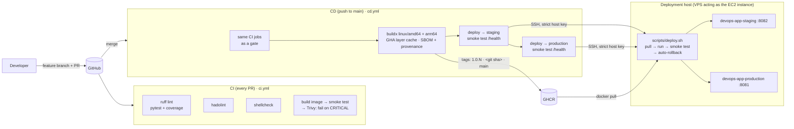
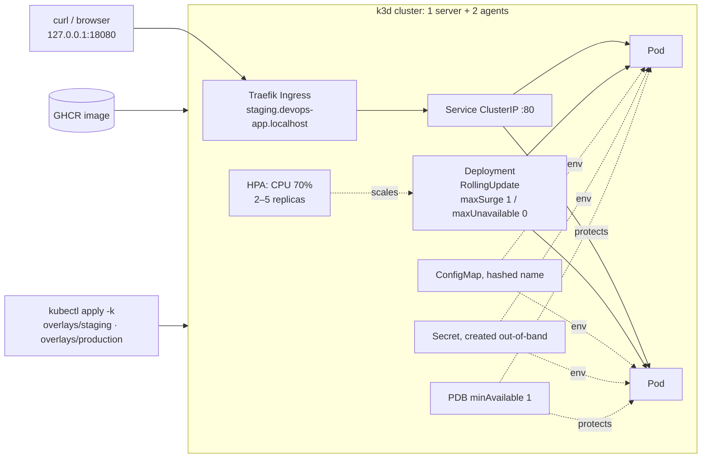
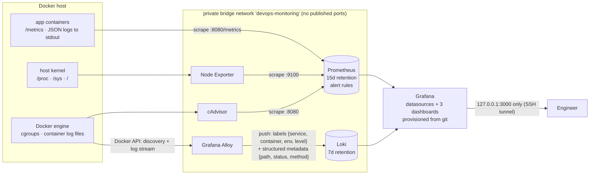
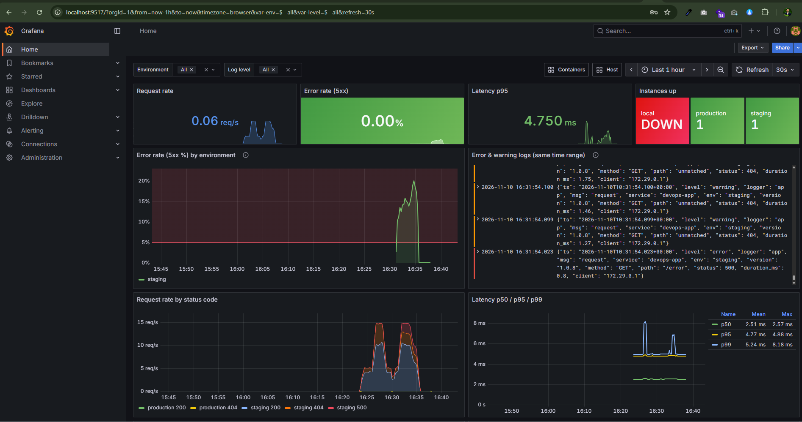
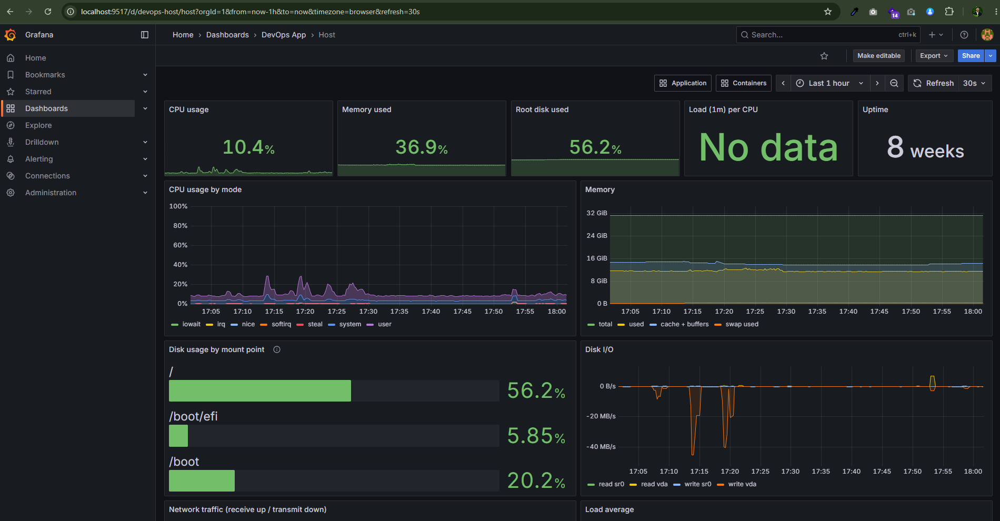
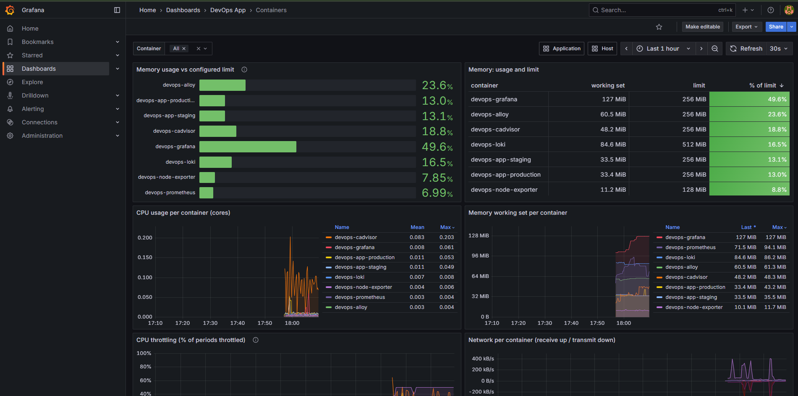

# fastapi-devops-pipeline

A small Python (FastAPI) web service taken end to end: containerized, tested and scanned in CI,
released as a multi-arch image, deployed with automatic rollback, provisioned with Terraform,
run on Kubernetes, and observed with Prometheus, Grafana, Loki, Alloy, Node Exporter and cAdvisor.

Every claim below is backed by a log in [`docs/evidence/`](docs/evidence/) or a screenshot in
[`docs/screenshots/`](docs/screenshots/), produced while building this.

> **Environment note (read first).** I don't have an AWS account. I therefore
> (1) wrote the Terraform for real AWS and validated/applied it against **LocalStack**
> (the code contains nothing LocalStack-specific), and (2) used my own **Linux VPS** as the
> deployment target that the EC2 instance would be. CD deploys to it over **SSH**, which the
> task allows ("via SSM or SSH"). The OIDC role and SSM permissions for the real-AWS path are
> already in [`terraform/oidc.tf`](terraform/oidc.tf). Details: [AWS environment](#aws-environment).

---

## Contents

1. [Architecture](#architecture)
2. [Repository layout](#repository-layout)
3. [Quick start: app + observability stack](#quick-start-app--observability-stack)
4. [Running everything](#running-everything): tests, health script, Terraform, Kubernetes
5. [Application](#application)
6. [Container image](#container-image)
7. [CI/CD pipeline](#cicd-pipeline)
8. [Deployment & rollback strategy](#deployment--rollback-strategy)
9. [Infrastructure as Code (Terraform)](#infrastructure-as-code-terraform)
10. [Kubernetes](#kubernetes)
11. [Observability](#observability)
12. [Linux automation: `system_health.sh`](#linux-automation-system_healthsh)
13. [Design decisions](#design-decisions)
14. [Security considerations](#security-considerations)
15. [AWS cost estimate](#aws-cost-estimate)
16. [What I would improve with more time](#what-i-would-improve-with-more-time)
17. [Use of AI tools](#use-of-ai-tools)

---

## Architecture

### Commit → CI → registry → deployment



### Kubernetes deployment flow



### Observability: how metrics and logs reach Grafana



---

## Repository layout

```
.
├── app/                         FastAPI service (main.py, config.py, logging_setup.py, metrics.py)
├── tests/                       pytest unit tests (10 tests, 92% coverage)
├── Dockerfile  .dockerignore    multi-stage Alpine image, non-root, HEALTHCHECK, OCI labels
├── docker-compose.yml           app on :8080 (health check, restart policy, limits)
├── docker-compose.monitoring.yml  Prometheus, Grafana, Loki, Alloy, Node Exporter, cAdvisor
├── monitoring/
│   ├── prometheus/              prometheus.yml, alerts.yml, file_sd targets (local | vps)
│   ├── loki/config.yml          single binary, tsdb v13, 7d retention via compactor
│   ├── alloy/config.alloy       Docker discovery → JSON parsing → Loki
│   └── grafana/                 provisioning (datasources, dashboard provider) + dashboards/*.json
├── .github/
│   ├── workflows/ci.yml         PR checks (also reused by CD as its gate)
│   ├── workflows/cd.yml         build/push multi-arch → staging → production; manual rollback input
│   ├── workflows/deploy.yml     reusable SSH deploy job
│   └── dependabot.yml           keeps image / pip / Actions pins current
├── scripts/
│   ├── deploy.sh                runs on the host: pull, run, smoke test, auto-rollback
│   ├── system_health.sh         host health check (Step 6)
│   ├── systemd/  cron/          every-5-minute schedule (systemd timer or cron)
│   └── generate_traffic.sh      demo traffic / error spikes for dashboards and alerts
├── k8s/
│   ├── base/                    Deployment, Service, Ingress, HPA, PDB, ServiceAccount, ConfigMap generator
│   ├── overlays/{staging,production}/   namespace (restricted PSS), replicas, env, host
│   ├── k3d-config.yaml          local cluster (Traefik + metrics-server bundled)
│   ├── rollout-demo.sh          zero-downtime update + rollout undo, with a live probe
│   └── secret.example.env       Secret template (real values never committed)
├── terraform/
│   ├── *.tf  templates/         EC2, SG, IAM, CloudWatch, GitHub OIDC; S3 backend with native locking
│   ├── envs/                    staging / production tfvars + backend configs
│   ├── bootstrap/               state bucket (versioned, encrypted, TLS-only)
│   └── localstack/              LocalStack compose + run.sh that produces the evidence logs
└── docs/evidence/  docs/screenshots/
```

---

## Quick start: app + observability stack

### Prerequisites

| Tool | Version used | Needed for |
|---|---|---|
| Docker Engine + Compose v2 | 29.x / v5.x | everything below |
| Linux host (or WSL2) | Ubuntu 24.04 | Node Exporter and cAdvisor need real host `/proc`, `/sys` and cgroups. Docker Desktop on macOS/Windows works for the app, but host and container metrics will be partial. |
| `curl` | any | smoke tests |

### 1. Run the app only (port 8080)

```bash
git clone https://github.com/shadat3500/fastapi-devops-pipeline.git
cd fastapi-devops-pipeline
docker network create devops-app-net          # once; shared by app, CD-deployed containers and Prometheus
docker compose up -d --build
curl localhost:8080/          # {"message":"Hello from DevOps Task!","status":"running","version":"1.0.0"}
curl localhost:8080/health    # {"status":"ok"}
curl localhost:8080/metrics   # Prometheus text format
```

Port 8080 is taken on your machine? Run `APP_HOST_PORT=8081 docker compose up -d`.

### 2. App + full observability stack

```bash
cp .env.example .env
# Edit .env and set GF_ADMIN_PASSWORD (required: compose refuses to start without it), e.g.:
sed -i "s/^GF_ADMIN_PASSWORD=.*/GF_ADMIN_PASSWORD=$(openssl rand -base64 18)/" .env

docker compose -f docker-compose.yml -f docker-compose.monitoring.yml up -d --build
docker compose -f docker-compose.yml -f docker-compose.monitoring.yml ps
```

### 3. Open Grafana

Grafana is the **only** published port, and it is bound to **127.0.0.1** only.

* Same machine: open <http://localhost:3000>.
* Remote server: tunnel it with `ssh -L 3000:127.0.0.1:3000 user@server`, then open <http://localhost:3000>.

Log in as `admin` with the password from `.env`. The **Application** dashboard is the home page.
All three dashboards are in the folder **Dashboards → DevOps App**.

### 4. Generate traffic (and an error spike)

```bash
bash scripts/generate_traffic.sh -u http://localhost:8080 -d 300 -r 10        # normal traffic
# Error spike: enable the demo endpoint (GET /error → 500), then send 20% errors
ENABLE_ERROR_ENDPOINT=true docker compose up -d app
bash scripts/generate_traffic.sh -u http://localhost:8080 -d 420 -r 10 -e 20
```

> **VPS setup used for the screenshots.** The VPS is shared with other projects, so ports 8080
> and 3000 were already taken. I ran the CD-deployed releases on **8082 (staging)** and
> **8081 (production)**, Grafana on **9517** (`GRAFANA_HOST_PORT=9517`), and set
> `PROM_TARGETS=vps`, so Prometheus scrapes `devops-app-staging` and `devops-app-production`
> instead of the compose app.

---

## Running everything

### Unit tests and lint

```bash
# no local Python needed
docker run --rm -v "$PWD":/w -w /w python:3.13.9-alpine3.22 sh -c \
  "pip install -q --root-user-action=ignore -r requirements-dev.txt && ruff check . && pytest --cov=app"
```

Result: **10 passed, 92% coverage**. The minimum, `fail_under = 80`, is enforced in `pyproject.toml`.

### Health script

```bash
bash scripts/system_health.sh                       # report, log to ./health_log.txt, exit 0/1/2
bash scripts/system_health.sh --json --disk 70      # JSON output, custom threshold
bash scripts/system_health.sh --help
```
Scheduling (every 5 minutes) is covered in [Linux automation](#linux-automation-system_healthsh).

### Terraform (against LocalStack; identical commands with `terraform` on real AWS)

```bash
# tools: terraform >= 1.10, plus pipx install terraform-local "awscli-local[ver1]"
read -rsp 'LocalStack token: ' LOCALSTACK_AUTH_TOKEN; echo; export LOCALSTACK_AUTH_TOKEN
docker compose -f terraform/localstack/docker-compose.yml up -d
bash terraform/localstack/run.sh apply     # bootstrap state bucket → fmt/validate → plan/apply staging → plan production
bash terraform/localstack/run.sh destroy
```

On real AWS:
```bash
cd terraform/bootstrap && terraform init && terraform apply && cd ..
terraform init -backend-config=envs/staging.backend.hcl
terraform plan  -var-file=envs/staging.tfvars -out=staging.tfplan
terraform apply staging.tfplan
terraform init -reconfigure -backend-config=envs/production.backend.hcl
terraform plan  -var-file=envs/production.tfvars
```

### Kubernetes (k3d)

```bash
# tools: k3d v5.8, kubectl 1.31
k3d cluster create --config k8s/k3d-config.yaml
kubectl apply -k k8s/overlays/staging
kubectl -n devops-staging rollout status deployment/devops-app
curl --resolve staging.devops-app.localhost:18080:127.0.0.1 http://staging.devops-app.localhost:18080/
bash k8s/rollout-demo.sh 1.0.2          # rolling update to 1.0.2 + rollout undo, with a live probe
k3d cluster delete devops
```

---

## Application

[`app/main.py`](app/main.py), FastAPI on Uvicorn, Python 3.13.

| Endpoint | Behaviour |
|---|---|
| `GET /` | `{"message": "Hello from DevOps Task!", "status": "running", "version": "<APP_VERSION>"}` |
| `GET /health` | `200 {"status":"ok"}`; `503` while shutting down. Used for liveness, readiness, the Docker HEALTHCHECK and CD smoke tests. |
| `GET /metrics` | Prometheus text format |
| `GET /error` | **Only if `ENABLE_ERROR_ENDPOINT=true`** (default off): always 500, for demoing dashboards and alerts |

* **Configuration** comes only from environment variables: `PORT`, `LOG_LEVEL`, `APP_ENV`, `APP_VERSION`, `ENABLE_ERROR_ENDPOINT` ([`app/config.py`](app/config.py)).
* **Metrics** ([`app/metrics.py`](app/metrics.py)):
  * `http_requests_total{method,path,status}`
  * `http_errors_total{method,path}` (5xx and unhandled exceptions)
  * `http_request_duration_seconds{method,path}` (histogram, 5 ms to 5 s buckets)
  * `http_requests_in_progress`
  * `app_info{version,env}`

  The `path` label is the **route template**, and every unknown URL becomes `path="unmatched"`. That way a scanner hitting thousands of random URLs can't create thousands of time series.
* **Structured logs**: one JSON object per line on stdout, with `ts, level, logger, msg, service, env, version` and, for requests, `method, path, status, duration_ms, client`. Uvicorn's own logs go through the same formatter, and its plain-text access log is disabled.
* **Graceful shutdown**: Python is PID 1 (exec-form `ENTRYPOINT`). On SIGTERM, Uvicorn stops accepting connections and drains in-flight requests (`timeout_graceful_shutdown=20`). The lifespan hook then logs `shutdown complete`. CI verifies this: the container must exit with code **0** after `docker stop`.

---

## Container image

[`Dockerfile`](Dockerfile)

| Requirement | How |
|---|---|
| Multi-stage, minimal final image | The builder creates a virtualenv; the runtime copies only `/opt/venv` and `app/` |
| Pinned base | `python:3.13.9-alpine3.22`, written literally in both `FROM` lines so hadolint (DL3006) and Dependabot can read it |
| Non-root | User `10001:10001`, the same UID Kubernetes enforces with `runAsUser` |
| HEALTHCHECK | Uses the image's own Python (`urllib`), so no curl or wget needs to be installed |
| OCI labels | title, description, version, revision (git SHA), created, source, licenses |
| `.dockerignore` | **Allow-list**: everything is excluded except `app/` and `requirements.txt` |
| Smaller attack surface | `pip` removed from the runtime image; `PYTHONDONTWRITEBYTECODE`, so the root filesystem can be read-only |

**Final image size: 22 MB compressed (registry/pull size), 91.7 MB on disk** (`docker images`).

**CVE handling:** the first CI run was blocked by Trivy because of **CVE-2026-31789 (CRITICAL, OpenSSL
3.5.4-r0)**, which came with the base image. A fixed package (3.5.6-r0) existed, so I fixed it rather than
suppressing it: the runtime stage runs `apk upgrade --no-cache libcrypto3 libssl3`, which upgrades only
those two packages. `.trivyignore` exists for accepted risks but is empty.

---

## CI/CD pipeline

### On every pull request: [`ci.yml`](.github/workflows/ci.yml)

Four parallel jobs:

1. **Lint, test & coverage**: `ruff`, then `pytest --cov`. A coverage table goes into the job summary, and `coverage.xml` plus `junit.xml` are uploaded as artifacts.
2. **hadolint** on the Dockerfile (`failure-threshold: warning`).
3. **shellcheck** at `--severity=style` (the strictest level) on every tracked `*.sh`.
4. **Build, smoke test & scan**:
   * builds the image (with the GHA cache)
   * runs it read-only, checks `/`, `/health` and `/metrics`, and **checks for a clean SIGTERM exit**
   * runs a Trivy report (HIGH and CRITICAL, informational), then a **Trivy gate that fails on CRITICAL**

Tool images (hadolint, shellcheck, Trivy) are pinned to versions in one `env` block.

### On push to `main`: [`cd.yml`](.github/workflows/cd.yml)

1. **CI gate.** The same `ci.yml` runs again via `workflow_call`, so nothing that fails a check gets pushed.
2. **Build & push.** `docker/build-push-action` builds **linux/amd64 and linux/arm64** (QEMU and Buildx) with the **GitHub Actions layer cache** (`type=gha,mode=max`), and attaches an **SBOM and provenance** attestation.
3. **Tags.** Each image gets three tags:
   * **`1.0.<run_number>`** (semantic version): MAJOR.MINOR come from the [`VERSION`](VERSION) file, which a person bumps; PATCH is the CD run number, so it always increases.
   * the **full git SHA**: immutable and traceable to a commit.
   * **`main`**: a convenience pointer. Nothing deploys `latest`.
4. **Deploy to staging, then production.** This uses the reusable [`deploy.yml`](.github/workflows/deploy.yml), with **GitHub Environments** for per-environment secrets and an optional required reviewer. Production only runs if staging succeeded.
5. **Manual redeploy or rollback.** Run CD with **Run workflow** and an existing `image_tag` input. The build is skipped and that tag is deployed.

Concurrency is `cd-main` with `cancel-in-progress: false`, so deploys queue and are never cut off halfway.

### Secrets and variables

Configured in **Settings → Environments → `staging` / `production`**. None are hardcoded.

| Name | Type | Purpose |
|---|---|---|
| `DEPLOY_HOST` | secret | target host IP or DNS name |
| `DEPLOY_USER` | secret | SSH user on the target |
| `DEPLOY_SSH_KEY` | secret | private key of a **deploy-only** ed25519 key pair (its public half is in the host's `authorized_keys`) |
| `DEPLOY_KNOWN_HOSTS` | secret | output of `ssh-keyscan -t ed25519 <host>`, used for **strict host-key checking** (no trust-on-first-use) |
| `APP_HOST_PORT` | variable | host port per environment (staging `8082`, production `8081` on my VPS) |
| `SSH_PORT` | variable (optional) | defaults to 22 |
| `GITHUB_TOKEN` | automatic | pushes to GHCR. During a deploy it also logs the host in to GHCR (in an isolated `DOCKER_CONFIG`, logged out afterwards). The token expires when the job ends. |

On real AWS, the four SSH secrets are replaced by **`AWS_ROLE_ARN`**, the `github_deploy_role_arn` Terraform output. `aws-actions/configure-aws-credentials` then exchanges the job's OIDC token for short-lived credentials, and the job runs `aws ssm send-command` against `EC2_INSTANCE_ID`. No access keys are involved.

### Evidence

| | |
|---|---|
| PR checks all green |  |
| Trivy gate blocking CVE-2026-31789 |  |
| CD: CI gate → build → staging → production |  |
| CD automatic rollback (staging red, production skipped) |  · full log: [`docs/evidence/cd-auto-rollback.log`](docs/evidence/cd-auto-rollback.log) |

---

## Deployment & rollback strategy

**How a release reaches production safely:**

1. Each change goes through a **PR**: lint, tests (coverage ≥ 80%), Dockerfile and shell lint, image build, container smoke test and a **CRITICAL-CVE gate**. A branch ruleset on `main` makes these checks required before merge.
2. On merge, CD **re-runs the same gate**, then builds **one immutable image** with a semver tag and a SHA tag. Staging and production get the **same digest**, never a rebuild.
3. **Staging first.** [`scripts/deploy.sh`](scripts/deploy.sh) does the following:
   * **pulls the image before stopping anything**, so a bad tag or registry outage leaves the running release untouched
   * starts the new container with the same hardening as compose: read-only root, `cap-drop ALL`, `no-new-privileges`, memory and CPU limits
   * smoke-tests `/health` up to 10 times, 3 s apart
4. **Production only runs if staging is healthy.** It can be gated with a required reviewer on the `production` environment.

**Automatic rollback:** if the smoke test fails, `deploy.sh`:
* prints the failing container's last logs
* restarts the **previous tag**, read from `~/devops-app/<env>/current_tag`
* verifies that the previous tag is healthy
* **exits non-zero, so the pipeline turns red** and the history file records `failed` and `rolled-back-to`

If the rollback also fails, it exits `2`: page a human.

**This was proven on purpose.** PR #5 shipped release `1.0.7` with `/health` returning 500 in staging only.
It passed the unit tests and the CI smoke test. Then the staging smoke test failed 10 times, `deploy.sh`
restored `1.0.2`, the job failed, and **production was skipped**. The fix went out as a normal revert PR (`1.0.8`).

```
deploying …:1.0.7 (previous: 1.0.2)
smoke test attempt 1/10 failed … 10/10 failed
FAILURE: 1.0.7 did not become healthy. Last container logs: {… "path": "/health", "status": 500 …}
ROLLBACK: restoring …:1.0.2
smoke test passed (attempt 2/10)
rollback to 1.0.2 succeeded; failing the deploy so CI shows red
```

**Manual rollback:** **Actions → CD → Run workflow → `image_tag` = a previous version** (for example `1.0.2`, or a commit SHA). The
build is skipped and that exact image goes through staging and then production with the same smoke tests.
On Kubernetes: `kubectl rollout undo` (demonstrated below).

**Known limitation:** stop-then-start on a single host means a few seconds of downtime per deploy. Blue/green
behind a reverse proxy, or an ALB with two targets, would remove it. See [improvements](#what-i-would-improve-with-more-time).
Kubernetes already does zero-downtime updates.

---

## Infrastructure as Code (Terraform)

[`terraform/`](terraform/) uses AWS provider `~> 6.0` (locked at 6.72.0) and Terraform `>= 1.10` (tested with 1.17.1).

| Requirement | Implementation |
|---|---|
| EC2 in a VPC | Default VPC (acceptable for one instance; see design decisions). Amazon Linux 2023 resolved via AWS's public SSM parameter, so there are no hardcoded AMI IDs. **IMDSv2 required.** Encrypted gp3 root volume. `ignore_changes = [ami]`, so a new AMI never silently replaces a running server. |
| Security group, only required ports | **Ingress: only the app port (8080) from `allowed_ingress_cidrs`. No port 22**, because access is via SSM Session Manager. Egress is limited to 443 and 80 (image pulls, packages, SSM and CloudWatch endpoints). |
| Least-privilege instance profile | `AmazonSSMManagedInstanceCore`, plus an inline policy allowing only `logs:CreateLogStream / PutLogEvents / DescribeLogStreams` on **this environment's log group**. No ECR permissions, because images come from GHCR. No static keys. |
| User data | [`templates/user_data.sh.tftpl`](terraform/templates/user_data.sh.tftpl): security updates, then installs Docker, then runs the hardened container with the **`awslogs` log driver**, then waits for `/health` |
| Logs to CloudWatch with retention | `aws_cloudwatch_log_group` `/devops-app/<env>/app`: **7 days in staging, 30 in production** (validated against the values CloudWatch accepts) |
| Remote state with locking | S3 backend with **`use_lockfile = true`** (S3-native locking, Terraform ≥ 1.10, no DynamoDB). The state bucket ([`bootstrap/`](terraform/bootstrap/main.tf)) is **versioned, encrypted, has public access blocked and denies non-TLS access**, with `prevent_destroy`. |
| Staging and production from the same code | `envs/<env>.tfvars` (instance type, disk, retention, CIDRs) plus `envs/<env>.backend.hcl` (**separate state key**). An `environment` variable validation allows only `staging` or `production`. |
| CD without long-lived keys | [`oidc.tf`](terraform/oidc.tf): a GitHub OIDC provider, created once per account by staging and **looked up** by production. The deploy role trusts only `repo:shadat3500/fastapi-devops-pipeline:environment:<env>`, can **only** run `ssm:SendCommand` on **this instance** with `AWS-RunShellScript`, and can read the command results. |

All resources get `Project`, `Environment`, `ManagedBy` and `Repository` tags via `default_tags`.

**Evidence (LocalStack 2026.10.6):** [`docs/evidence/terraform-apply.log`](docs/evidence/terraform-apply.log) and
[`terraform-destroy.log`](docs/evidence/terraform-destroy.log):
* the state bucket is bootstrapped and versioning is `Enabled`
* `fmt -check` and `validate` pass
* staging: **`Plan: 13 to add` → `Apply complete! Resources: 13 added`**
* the instance is `running`, the SG allows only `tcp 8080`, the log group has 7-day retention, both IAM roles exist, and the state object is at `devops-app/staging/terraform.tfstate` in S3
* production with the **same code**: **`Plan: 12 to add`** (`t3.small`, 20 GB, 30-day logs, reuses the OIDC provider)
* `Destroy complete! Resources: 13 destroyed.`

### AWS environment

* **What LocalStack proves:** the HCL is valid, every resource's API calls succeed, the dependency graph and outputs are correct, the S3 backend works, and the same code produces the right plan per environment.
* **What it does not prove:** EC2 is emulated (no VM boots and user data doesn't run), so **CloudWatch log delivery and IAM enforcement are not exercised**. The VPS plays the EC2 role for real: Docker, hardened container, automated deploy and rollback.
* **Two issues fixed while testing, both worth knowing:**
  1. LocalStack 4.9 couldn't serve the `s3control` tag API that AWS provider v6 now calls for buckets, so I pinned a current LocalStack instead of downgrading the provider.
  2. I replaced a hardcoded mock AMI with the real SSM AMI lookup, so the production code path is what gets tested.

---

## Kubernetes

[`k8s/`](k8s/) uses Kustomize: one `base/`, plus `overlays/staging` and `overlays/production`.

| Requirement | Implementation |
|---|---|
| Deployment, ≥ 2 replicas, rolling update | 2 replicas (3 in production). `RollingUpdate` with **`maxSurge: 1`, `maxUnavailable: 0`**, `minReadySeconds: 5`, `progressDeadlineSeconds: 120`, `revisionHistoryLimit: 5` |
| Probes on `/health` | **startup** (up to 30 s), **readiness** (traffic gating, every 5 s) and **liveness** (restarts a hung process, every 10 s). A `preStop` sleep of 5 s lets endpoints drain before SIGTERM. |
| Requests and limits | requests `50m` / `64Mi`, limits `500m` / `256Mi` |
| Service + Ingress | ClusterIP `:80 → 8080`. Traefik Ingress `staging.devops-app.localhost` / `devops-app.localhost`, exposed on `127.0.0.1:18080` |
| ConfigMap | Generated by `configMapGenerator` with a content hash, so a config change **rolls the pods automatically** |
| Secret | `devops-app-secret` is referenced with `optional: true` and **never committed**. Create it from [`secret.example.env`](k8s/secret.example.env) with `kubectl create secret generic … --from-env-file`. (The app has no real secret today; this is the delivery path a DB password would take.) |
| securityContext | `runAsNonRoot`, UID/GID 10001, **`readOnlyRootFilesystem: true`**, `allowPrivilegeEscalation: false`, `capabilities.drop: [ALL]`, `seccompProfile: RuntimeDefault`. The only writable path is an in-memory `emptyDir` on `/tmp`. The namespaces **enforce the `restricted` Pod Security Standard**. |
| HPA | CPU at **70% of the request**, 2–5 replicas (production 3–10). Scales up quickly and waits 120 s before scaling down, to avoid flapping. |
| Extra | PodDisruptionBudget (`minAvailable` 1, or 2 in production), topology spread across nodes, a dedicated ServiceAccount with no API token mounted |

**Why k3d:** it bundles **Traefik** (so no separate ingress controller is needed; the commonly used ingress-nginx was retired in 2026)
and **metrics-server** (which the HPA needs). The cluster has 1 server and 2 agents, so the replicas really spread across nodes.

### Zero-downtime rolling update and rollback

[`k8s/rollout-demo.sh`](k8s/rollout-demo.sh) sends a request through the Ingress every 0.2 s **while** it
updates the Deployment and then rolls it back. Full output: [`docs/evidence/k8s-rollout-demo.log`](docs/evidence/k8s-rollout-demo.log).

```console
$ bash k8s/rollout-demo.sh 1.0.2
$ kubectl -n devops-staging set image deployment/devops-app app=ghcr.io/shadat3500/fastapi-devops-pipeline:1.0.2
$ kubectl -n devops-staging rollout status deployment/devops-app --timeout=180s
Waiting for deployment "devops-app" rollout to finish: 1 out of 2 new replicas have been updated...
Waiting for deployment "devops-app" rollout to finish: 1 old replicas are pending termination...
deployment "devops-app" successfully rolled out
$ kubectl -n devops-staging get pods -l app.kubernetes.io/component=web -o wide
devops-app-77c45d8774-fml7r   1/1   Running       0   13s   10.42.0.6   k3d-devops-agent-0
devops-app-77c45d8774-nhcrq   1/1   Running       0   24s   10.42.1.5   k3d-devops-agent-1
devops-app-c888b5bfb-nd7wb    1/1   Terminating   0   2m29s 10.42.2.3   k3d-devops-server-0
$ kubectl -n devops-staging rollout history deployment/devops-app
REVISION  CHANGE-CAUSE
1         <none>
2         rollout demo: update to 1.0.2

$ kubectl -n devops-staging rollout undo deployment/devops-app
deployment.apps/devops-app rolled back
$ kubectl -n devops-staging rollout status deployment/devops-app --timeout=180s
deployment "devops-app" successfully rolled out
$ kubectl -n devops-staging get deployment/devops-app -o jsonpath={.spec.template.spec.containers[0].image}
ghcr.io/shadat3500/fastapi-devops-pipeline:1.0.8

=== probe summary: 246 requests, 0 non-200 ===
    114   200  version=1.0.2
    132   200  version=1.0.8
```

**246 requests and 0 failures** during the update and the rollback, with both versions serving while pods were replaced.

### How this would change for production on EKS

| Concern | Local (k3d) | EKS |
|---|---|---|
| Ingress | Traefik, plain HTTP | **AWS Load Balancer Controller** → ALB (IP targets), **ACM certificate / HTTPS**, WAF, ExternalDNS for Route 53 records |
| Secrets | `kubectl create secret` by hand | **External Secrets Operator** syncing from **AWS Secrets Manager / SSM Parameter Store**. Optionally KMS envelope encryption of Secrets in etcd |
| AWS access from pods | none | **IRSA or EKS Pod Identity**: one IAM role per ServiceAccount, no node-wide credentials |
| Node scaling | fixed 3 nodes | **Karpenter** (or Cluster Autoscaler) across **multiple AZs**. Spot for stateless workloads, on-demand for system pods |
| Images | GHCR | **ECR** with scan on push, pulled via node role or IRSA. **Image signature verification** (Cosign plus Kyverno or Sigstore policy-controller) |
| Delivery | `kubectl apply -k` | **GitOps** (Argo CD or Flux) from this repo, with Argo Rollouts for canary analysis on the Prometheus error rate |
| Observability | separate Docker stack | kube-prometheus-stack (or Amazon Managed Prometheus / Grafana), Loki or CloudWatch Container Insights, alerts to Alertmanager → Slack |
| Resilience | PDB, topology spread | the same, plus spread across **zones** (`topology.kubernetes.io/zone`), PriorityClasses, NetworkPolicies (VPC CNI network policy), PSA `restricted`, private API endpoint |
| Provisioning | k3d config | Terraform (`terraform-aws-modules/eks`) with managed add-ons (VPC CNI, CoreDNS, kube-proxy, EBS CSI) |

---

## Observability

[`docker-compose.monitoring.yml`](docker-compose.monitoring.yml) runs all six required components,
with **pinned versions** and **resource limits** on every container:

| Component | Version | Role |
|---|---|---|
| Prometheus | v3.5.0 | scrapes the app, Node Exporter, cAdvisor and the stack itself; evaluates alert rules; **retention 15 days** (plus a 2 GB size cap) |
| Loki | 3.5.0 | log store: single binary, tsdb schema v13, **retention 7 days** (`retention_period: 168h` **with** `compactor.retention_enabled: true`, without which retention silently does nothing) |
| Grafana Alloy | v1.9.0 | Docker service discovery → tails container logs → parses JSON → pushes to Loki |
| Node Exporter | v1.9.1 | host CPU, memory, disk, network, load |
| cAdvisor | v0.52.1 | per-container CPU, memory, limits, throttling, network |
| Grafana | 12.1.1 | datasources and dashboards **provisioned from files in git** (`allowUiUpdates: false`) |

### Metrics collection

[`prometheus.yml`](monitoring/prometheus/prometheus.yml), scrape interval 15 s:

* **The app** via `file_sd`: `targets/local` (the compose app) or `targets/vps` (the CD-deployed `devops-app-staging` and `devops-app-production`), selected with `PROM_TARGETS`, so the same config works in both places. Every target carries an `env` label.
* **Node Exporter** on the monitoring network's gateway IP (see below).
* **cAdvisor**, with non-container cgroup series dropped at scrape time.
* **The stack itself**: Prometheus, Loki, Alloy and Grafana.

On the VPS, all 8 targets were `up`.

### Log collection and label choices

[`config.alloy`](monitoring/alloy/config.alloy): `discovery.docker` → `loki.source.docker` → `loki.process` → `loki.write`.

* **Opt-in discovery.** Only containers with a `logging.service` label are collected (the app, CD releases and the monitoring stack). The VPS is **shared with other teams' containers**, and their logs are not mine to ingest.
* **Labels (stream selectors), kept low-cardinality on purpose:**

  | Label | Values | Why it's a label |
  |---|---|---|
  | `service` | app, prometheus, loki, alloy, grafana, … | first thing you filter on |
  | `env` | local, staging, production | separates releases |
  | `container` | one per container | about 10 values |
  | `stream` | stdout, stderr | 2 values |
  | `level` | debug, info, warning, error, critical | parsed from the app's JSON; **5 fixed values** |

* **Not labels, but structured metadata:** `path`, `status` and `method`. They're filterable in LogQL without a JSON parse (`{service="app"} | path="/error" | status="500"`), but they **don't create a stream per value**. Loki's performance depends on keeping the stream count small. A label per path or status code would multiply streams, and a label per request ID or client IP would explode them.
* The log timestamp comes from the app's own `ts` field, not the time Alloy read the line.

### Dashboards (provisioned from [`monitoring/grafana/dashboards/`](monitoring/grafana/dashboards/))

| Dashboard | Panels |
|---|---|
| **Application** (home) | request rate, 5xx error rate, p95, instances up (stat row); **error rate by environment, with the error and warning log panel directly beside it**; request rate by status; **latency p50 / p95 / p99**; requests by path; errors by path; all app logs filtered by the `Log level` variable. Variables: `Environment`, `Log level`. |
| **Host** | CPU %, memory %, root disk %, load per CPU, uptime; CPU by mode; memory (used, cache, swap); **disk usage per mount point**; disk I/O; **network rx/tx**; load average vs core count |
| **Containers** | **memory working set as % of the configured limit** (bar gauge and table, only for containers that have a limit); CPU cores per container; memory per container; CPU throttling %; network per container. The `Container` variable's "All" shows only this project's `devops-*` containers on the shared host. |

| Application | Host | Containers |
|---|---|---|
|  |  |  |

### Alerting rules ([`alerts.yml`](monitoring/prometheus/alerts.yml))

They're visible in Grafana under **Alerting → Alert rules** (data-source managed).

| Alert | Condition | `for` | Why this threshold and duration |
|---|---|---|---|
| **AppInstanceDown** (critical) | `up{job="app"} == 0` | 1m | Four failed scrapes in a row at a 15 s interval. A normal restart or deploy takes under 30 s, so releases don't page; a crash does within about a minute. |
| **AppHighErrorRate** (critical) | 5xx / all requests **> 5%** per env, **and** traffic > 0.1 req/s | 5m | 5% is far above the normal near-zero baseline, but low enough to catch a broken route. The traffic guard stops one failed request on an idle service (1 of 1 = 100%) from paging. 5 minutes ignores a brief blip but catches a bad release well before users give up. |
| **AppHighLatencyP95** (warning) | p95 **> 500 ms** | 10m | The app normally answers in about 5 ms (p95 measured at 4.75 ms), so 100× that is real saturation (CPU throttling, memory pressure), not noise. A warning, because slow isn't down. |
| **HostDiskUsageHigh** (warning) | any real filesystem **> 80%** | 10m | Leaves ~20% headroom to act before writes fail. Docker images and logs grow in bursts, so 10 minutes avoids firing on a temporary pull or build. |
| **HostHighCpu** (warning) | host CPU **> 90%** | 15m | This is a shared host. Short bursts from builds and deploys are normal; only a sustained 15 minutes means capacity is gone. |
| **ContainerMemoryNearLimit** (warning) | working set **> 90% of limit** | 5m | At 100% the kernel OOM-kills the container. 90% for 5 minutes signals a leak or under-sized limit before that happens. Only containers with a limit are evaluated. |

During the error-spike demo (20% of staging requests to `/error`), `AppHighErrorRate` moves to **Pending**
as soon as the ratio crosses 5%, and to **Firing** once it has held for 5 minutes:


### Hygiene and security of the stack

* **Credentials:** `GF_SECURITY_ADMIN_PASSWORD` comes from `.env` (git-ignored) and is **required**: `${GF_ADMIN_PASSWORD:?…}` makes compose refuse to start without it. Sign-up and anonymous access are disabled.
* **Exposure:** **only Grafana publishes a port, bound to `127.0.0.1`**. Prometheus, Loki, Alloy, Node Exporter and cAdvisor have no published ports and talk over the private `devops-monitoring` bridge network (and Prometheus joins `devops-app-net` to reach the app).
* **Pinned versions:** every image tag is pinned.
* **Host access, granted deliberately:**

  | Container | Grants | Why |
  |---|---|---|
  | **Node Exporter** | `network_mode: host`, `pid: host`, `/:/host:ro,rslave` (`--path.rootfs=/host`) | It must see the **host's** network interfaces, processes and load, not the container's. In bridge mode, network stats would describe the container's own `eth0`. The root FS is mounted **read-only** for filesystem usage, and `rslave` propagates later mounts. **It listens only on the monitoring bridge gateway IP (`172.31.250.1:9100`)**: private and not routable from outside, so host networking doesn't expose it publicly. |
  | **cAdvisor** | `privileged: true`, `/dev/kmsg`, read-only `/`, `/var/run`, `/sys`, `/var/lib/docker`, `/dev/disk` | It reads cgroup statistics and Docker state for **every** container, and OOM events from the kernel log. `privileged` is the documented requirement for full cgroup v2 access. That's why it has **no published port**. Unused metric groups are disabled to reduce load and cardinality. |
  | **Alloy** | `/var/run/docker.sock:ro` | Docker discovery and log streaming. The socket is powerful even read-only (it's the full Docker API), so this is the stack's most sensitive grant. Production improvement: a socket proxy allowing only `GET /containers`. |

### Walkthrough: "An error spike appears on the Application dashboard. How do you find the cause?"

1. **Scope it on the same dashboard.** The *Error rate by environment* panel shows **which env**, and the *Instances up* tile shows whether it's a crash (DOWN) or a misbehaving but running app. In the demo, only `staging` rose, to about 20%, while production stayed at 0%.
2. **Find the failing route.** *Errors by path* breaks the 5xx down by route template. In the demo, all errors were on `/error`.
3. **Read the logs right beside the graph.** The *Error & warning logs* panel covers the same time range and environment. Each line shows `env level method path → status (duration)`, and expanding one shows every JSON field. That points to the code path and the message.
4. **Pivot in Explore if needed:** `{service="app", env="staging", level="error"} | path="/error"`, or `| status="500"` using structured metadata, or `| json | duration_ms > 500` for slow requests.
5. **Correlate with a release.** Did it start right after a CD run? The `version` field in each log line, and the deploy history (`~/devops-app/<env>/history.log` and the Actions tab), answer that. If it's the new release: **roll back** (Run workflow with the previous tag), then debug.
6. **Rule out resources.** On the **Containers** dashboard: memory near the limit (OOM restarts), CPU throttling (timeouts). On the **Host** dashboard: disk full, CPU saturated, network. A latency rise together with throttling points at the CPU limit, not the code.
7. **Confirm the fix** by watching the error rate fall back to 0 and `AppHighErrorRate` resolve.

---

## Linux automation: `system_health.sh`

[`scripts/system_health.sh`](scripts/system_health.sh), `set -euo pipefail`, **shellcheck-clean at `--severity=style`**.

* **Collects:**
  * CPU: two `/proc/stat` samples, busy = total − idle − iowait
  * memory: `MemAvailable`, plus swap
  * **every real mounted filesystem** (tmpfs, overlay, squashfs and similar excluded)
  * load average (1/5/15) against the core count
  * **top 5 processes by memory**
* **Thresholds:** `--cpu 90 --mem 85 --disk 80` for warning (defaults), `--cpu-crit 95 --mem-crit 95 --disk-crit 90` for critical. Values are validated as 0–100, and warn ≤ crit.
* **Output:** prints `[WARNING]` or `[CRITICAL]` lines. `--json` produces machine-readable output. `-q` silences stdout, but warnings still go to stderr for cron mail and journald.
* **Exit codes:** `0` healthy, `1` warning, `2` critical, **`3` unknown** (bad usage or an internal error, so a broken check never looks like "warning").
* **Log:** a timestamped entry is appended to `health_log.txt` (`--log FILE`): one summary line plus one line per warning, or one JSON line with `--json`.
* **Rotation:** before appending, if the log is larger than `--max-size` (default 1024 KB), it rotates `.1 … .N` and keeps `--keep` files (default 5). A `flock` stops concurrent runs (cron plus a manual run) from interleaving.
* **Ordering:** the log and the alert are written **before** stdout. I found this bug in testing: with `| head`, SIGPIPE used to kill the script before it logged.
* **Bonus:** if `HEALTH_WEBHOOK_URL` is set, warnings and criticals are POSTed to Slack or Discord (the format is detected from the URL). A failed delivery is reported but never changes the exit code.

Results on the VPS: normal run `exit=0`; `--disk 40` → `[WARNING] Disk usage on / at 55% exceeds threshold 40%`, `exit=1`;
`--cpu abc` → clear error, `exit=3`; 25 runs with `--max-size 1 --keep 3` → `rot.txt` plus `.1 .2 .3`, and no `.4`.


**Every 5 minutes, using systemd (recommended):**
```bash
sudo install -m 0755 scripts/system_health.sh /usr/local/bin/system_health.sh
sudo cp scripts/systemd/system-health.{service,timer} /etc/systemd/system/
sudo systemctl daemon-reload && sudo systemctl enable --now system-health.timer
systemctl list-timers system-health.timer; journalctl -u system-health
```
The [service](scripts/systemd/system-health.service) is hardened (`DynamicUser`, `ProtectSystem=strict`,
`NoNewPrivileges`, and only `/var/log/system-health` is writable), treats exit codes 1 and 2 as results rather than unit failures, and reads an
optional webhook URL from `/etc/default/system-health`. The [timer](scripts/systemd/system-health.timer) uses
`OnCalendar=*:0/5` with `Persistent=true`.

**Or with cron:** [`scripts/cron/system-health.cron`](scripts/cron/system-health.cron) → `/etc/cron.d/system-health`:
```
*/5 * * * * root /usr/local/bin/system_health.sh --quiet --log /var/log/system-health/health_log.txt >/dev/null
```

---

## Design decisions

**Python / FastAPI.** The fastest path to a correct, well-tested service with native Prometheus support
(`prometheus_client`). Go would give a smaller image (~10 MB), but I'd rather ship code I can explain line by line.

**Alpine vs distroless.** I chose `python:3.13.9-alpine3.22`:
* The official distroless Python image tracks Debian's Python (3.11 on Debian 12), while Alpine gives the current 3.13 with patch-level pinning.
* Alpine has a package manager for targeted CVE fixes, which mattered on day one: CVE-2026-31789 was fixed with a two-package `apk upgrade`.
* The image is still 22 MB compressed.
* Distroless wins on attack surface: no shell and no package manager. The trade-off with Alpine is musl. Every dependency here ships musllinux wheels, so nothing compiles.

**EC2 vs ECS vs EKS.** For one stateless service, **EC2 + Docker** is the simplest and cheapest thing that meets the brief. ECS Fargate would be my next step
(no hosts to patch, native rolling deploys, ~$10–15/month for this size). EKS costs **$73/month for the control plane alone** before any node, and only pays off with many services.
The Kubernetes manifests show I'd be ready for it when that's justified.

**Default VPC.** Acceptable for a single instance, and allowed by the task. For production I'd use a dedicated VPC with private subnets, an ALB in public subnets, and VPC endpoints for SSM, CloudWatch and ECR, so the instance needs no public IP.

**Tagging.** Images are immutable: semver `1.0.<run>` for humans and release notes, plus the full git SHA for traceability. Both point at the same digest, and the same digest is promoted from staging to production. `latest` is never deployed. `main` is only a moving pointer.

**Secrets strategy.** Nothing secret is in git (`.env`, `*.env` and `*.tfstate` are ignored; only `.env.example` and `*.example.env` templates are committed).
* **CI/CD:** GitHub **Environment** secrets, scoped per environment, plus the ephemeral `GITHUB_TOKEN`.
* **AWS:** **OIDC only**, so there are no access keys anywhere.
* **Runtime:** environment variables or env files on the host, and a Kubernetes Secret created out-of-band (External Secrets with Secrets Manager on EKS).
* **Grafana:** the password is required from `.env`.

**Log labels.** Only bounded values become Loki labels (`service, env, container, stream, level`). High-cardinality fields (`path, status, method`) go into structured metadata. See [Log collection and label choices](#log-collection-and-label-choices).

**Monitoring through the Docker API, opt-in.** On a shared host, collecting every container's logs would ingest other teams' data and multiply cardinality. A `logging.service` label is an explicit contract.

**SSH deploys on the VPS, SSM on AWS.** The task allows either. Without AWS, SSH with a **deploy-only key and a pinned host key** was the honest choice. The Terraform already contains the SSM-only OIDC role for the AWS version, so the switch is the deploy job, not the design.

**Reusable workflows.** `ci.yml` is both the PR check and the CD gate (one definition of "good"), and `deploy.yml` is one job used for both environments, so staging really rehearses production.

**k3d over kind/minikube.** It ships Traefik and metrics-server (needed by the Ingress and HPA), and starts multi-node in seconds.

---

## Security considerations

**Secrets management**
* No credentials in the repo or image. `.gitignore` covers `.env`, `*.env`, `*.tfstate` and plans, and Grafana won't start without a password from `.env`.
* GitHub Environment secrets per environment. The deploy SSH key is **single-purpose**, and its private half lives only in GitHub (the file is removed from the host after it is stored). **Strict host-key checking** uses a pinned `known_hosts`.
* GHCR login on the target uses the job's **ephemeral `GITHUB_TOKEN`**, in an isolated `DOCKER_CONFIG`, with **logout afterwards**.
* AWS: **GitHub OIDC with short-lived role sessions**, trusted only for this repo and the matching GitHub environment. No access keys exist.

**Image scanning and supply chain**
* A **Trivy gate fails CI on any CRITICAL vulnerability** (it caught CVE-2026-31789 and forced a real fix). A HIGH and CRITICAL report is printed on every run.
* hadolint and shellcheck run on every PR.
* Builds produce **SBOM and provenance attestations**.
* **Dependabot** watches the base image, Python packages and Actions.
* A minimal image: no pip, no compilers, no curl.

**IAM (least privilege)**
* **Instance role:** SSM agent, plus writes **only to its own log group**.
* **Deploy role:** `ssm:SendCommand` **only on this instance** with the `AWS-RunShellScript` document, plus read-only command results.
* The state bucket is private, encrypted, versioned and **denies non-TLS access**.

**Network exposure**
* **AWS:** the SG opens **only the app port**, with **no SSH (port 22 closed)** because access is via SSM. IMDSv2 is required. Egress is limited to 80 and 443.
* **Monitoring:** only Grafana is published, on **localhost**. Node Exporter binds a private bridge IP. LocalStack binds `127.0.0.1`.
* **Kubernetes:** the Ingress is bound to `127.0.0.1`. ClusterIP services. The restricted Pod Security Standard is enforced.

**Runtime hardening** (identical in compose, `deploy.sh`, user data and Kubernetes)
* non-root UID 10001, **read-only root FS**, `tmpfs /tmp`
* `cap-drop ALL`, `no-new-privileges`, seccomp `RuntimeDefault`
* CPU and memory limits, log size rotation

**Things I noticed on the shared VPS** (not mine to change; these are recommendations for its owner)
* sshd allows **password authentication**, and the auth log shows ongoing brute-force attempts on `root`.
* Several unrelated databases publish ports on `0.0.0.0`.

Recommendation: `PasswordAuthentication no`, fail2ban, and binding internal services to localhost or private networks. The deploy user here is in the `docker` group, which is effectively root on the host. In production I'd use a dedicated deploy user with a restricted `sudo` command or, on AWS, SSM.

---

## AWS cost estimate

A rough monthly estimate for running this in production, **us-east-1, on-demand list prices, 730 h/month**.
Prices change: confirm with the [AWS Pricing Calculator](https://calculator.aws/) before relying on them.

| Item | Production | Staging |
|---|---:|---:|
| EC2 (`t3.small` prod, `t3.micro` staging) | ~$15.20 | ~$7.60 |
| EBS gp3 (20 GB prod, 10 GB staging, at $0.08/GB-month) | ~$1.60 | ~$0.80 |
| Public IPv4 address ($0.005/h) | ~$3.65 | ~$3.65 |
| CloudWatch Logs (~2 GB ingested at $0.50/GB, plus storage) | ~$1.10 | ~$0.50 |
| Detailed monitoring (production only, about 7 metrics) | ~$2.10 | – |
| S3 state + requests | < $0.10 | – |
| Data transfer out (first 100 GB/month free) | ~$0 | ~$0 |
| **Subtotal (as built)** | **≈ $24** | **≈ $13** |
| *Recommended for real production:* ALB (~$16.40 + LCUs ~$6) | ~$22 | – |
| *Optional:* a second instance across AZs for HA | ~$20 | – |

**≈ $37/month for both environments as built**, or **≈ $80/month** with an ALB and a second production instance for high availability.
For comparison: ECS Fargate (0.25 vCPU / 0.5 GB, 2 tasks) is ~$18 plus an ALB, and EKS adds a $73 control plane.
Savings Plans or Reserved Instances cut the EC2 line by about 30–40% for a steady workload.

---

## What I would improve with more time

1. **Run it on real AWS.** Apply the Terraform, and switch the deploy job to `aws-actions/configure-aws-credentials` (OIDC) + `aws ssm send-command`, using the role already defined. Verify CloudWatch log delivery and IAM denies.
2. **Zero-downtime deploys on the single host.** Blue/green with a reverse proxy (two containers, switch upstream after the health check), or an ALB with two targets.
3. **Alerting delivery.** Alertmanager with routing to Slack or Discord, inhibition rules (AppInstanceDown suppresses AppHighErrorRate), and runbook links.
4. **Supply chain.** Pin every GitHub Action by **commit SHA** (I'd want Dependabot to manage those too), keyless **Cosign** signing, and signature verification at deploy time.
5. **Terraform in CI.** `fmt`, `validate`, `tflint`, `checkov` and a LocalStack `plan` on every PR touching `terraform/`; migrate from the deprecated `tflocal`/`awslocal` to LocalStack's `lstk`.
6. **Network.** A dedicated VPC with private subnets and VPC endpoints, an ALB with ACM/HTTPS, and no public IP on the instance.
7. **Kubernetes.** A Helm chart with staging and production values, NetworkPolicies, kube-prometheus-stack in-cluster with ServiceMonitors, and Argo CD for GitOps.
8. **Tracing.** OpenTelemetry instrumentation → Tempo, with exemplars linking latency spikes to traces.
9. **Small cleanups.**
   * Make `DEPLOY_USER` a variable instead of a secret: it isn't sensitive, and as a secret it gets masked inside image names in logs.
   * Bump the Actions currently running on deprecated Node 20 (Dependabot PRs #2 and #3 are open).
   * A socket proxy for Alloy's Docker access.
   * Automatic GHCR cleanup of old SHA tags.

---

## Use of AI tools

I used an AI coding assistant (Claude by Anthropic) as a pair-programmer throughout. It drafted most of the
code and configuration from my requirements and the task brief: the application, Dockerfile, workflows,
Terraform, manifests, monitoring configuration, scripts and this README. It also walked me through
diagnosing failures.

I ran and verified everything myself on my VPS and GitHub. Every result shown here comes from those runs,
not from the AI. That includes:
* the failed checks and the fixes that followed (hadolint DL3006, the Trivy CRITICAL CVE, missing GitHub environment variables, SSH `authorized_keys` permissions, LocalStack and provider API compatibility, a SIGPIPE ordering bug in the health script)
* the deliberate rollback and error-spike demos

I reviewed each file and can explain every part of the submission, including the trade-offs above.
